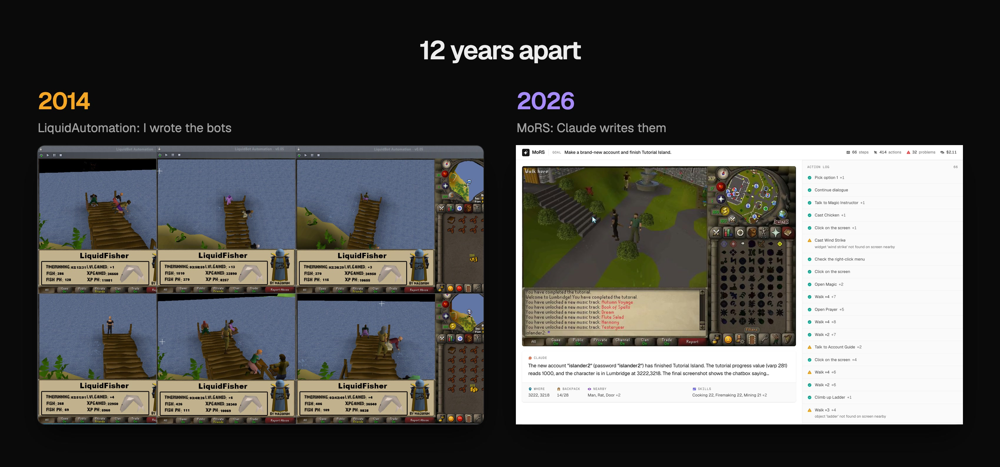
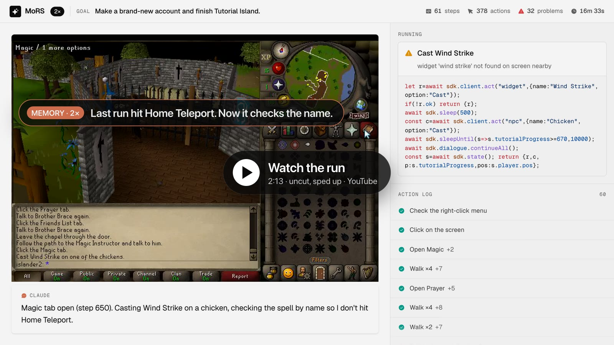
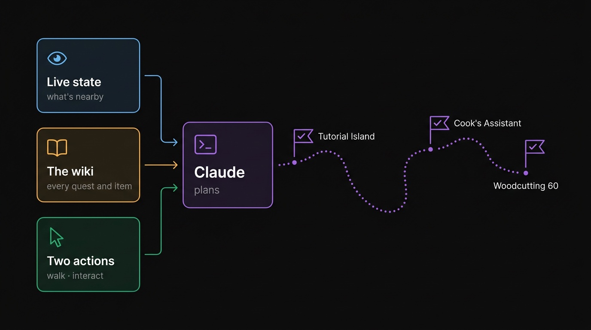
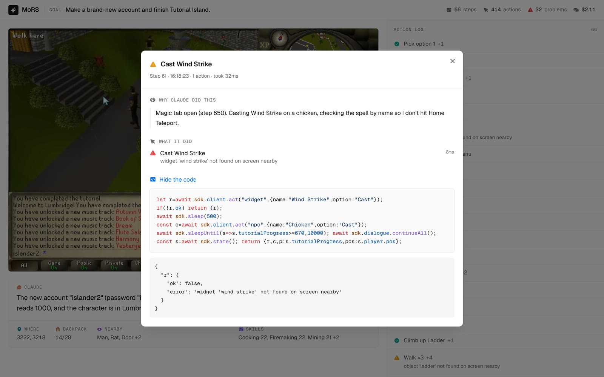

# MoRS

**Claude plays Old School RuneScape by writing code.**



When I was 13, I learned to code by writing bots for Old School RuneScape. Those bots grew into [LiquidAutomation](https://github.com/abuaboud/liquid-automation), which I built with Kenneth. The screenshot on the left shows it running six fishing bots at once. Writing the bots was fun. The hard part was the game itself: its code was scrambled and changed almost every week, so we had to figure it out again and again.

Twelve years later, there's [RuneLite](https://github.com/runelite/runelite). It gives you the same kind of API we built for LiquidAutomation, a clean way to read the game. But RuneLite is made for writing plugins, not bots, so it can't take actions. I added that part. This time, Claude writes the bots instead of me. The screenshot on the right shows it playing.

You give it a goal, like "finish Tutorial Island" or "get Woodcutting to 60". It looks around, writes some code, runs it, checks what happened, and tries again. It [keeps notes](#memory), so the next session picks up where the last one stopped. You can watch it all live.

> [!WARNING]
> Please run this on your own private server ([OpenRune](https://github.com/OpenRune)), not on Jagex's official servers.

[](https://youtu.be/aXqT2ASjgSU)

[Watch Claude finish Tutorial Island](https://youtu.be/aXqT2ASjgSU) from a brand-new account. It's the whole 18-minute run with nothing cut: sped up through the routine parts, slowed down where it gets stuck or uses its notes from the last run. Want to check? Here's the [uncut raw footage](proof/tutorial-island/raw.mp4) (17m 50s, real time), the [full log](proof/tutorial-island/log.jsonl) of every thought, script and action, and the video in [full quality](proof/tutorial-island/final.mp4). Every run below is in [one playlist](https://www.youtube.com/playlist?list=PLCsemk18cq-M).

## Long horizon tasks



Here's the bet: you don't need a huge API to play a game this big. You need three things:

- **A live view of what's around you.** Not the whole game, just the state within about 20 tiles of the player, fresh every time Claude asks.
- **The knowledge to make sense of it.** OSRS has a huge, detailed [wiki](https://oldschool.runescape.wiki) covering every quest, item and route, and Claude can lean on it.
- **A tiny way to act.** Walk, and interact with things by name. That's it.

Put Claude on top as the planner and it can chain hundreds of small steps into long tasks: finish a tutorial, run a whole quest, train a skill to 60. So far:

| Goal | How it went | Proof |
|---|---|---|
| Finish Tutorial Island | ✅ Done in 17m 46s, starting from a fresh account | [▶ video](https://youtu.be/aXqT2ASjgSU) · [raw footage](proof/tutorial-island/raw.mp4) · [log](proof/tutorial-island/log.jsonl) · [full quality](proof/tutorial-island/final.mp4) |
| Quest: Cook's Assistant | ✅ Done in 9m 51s from one prompt, no walkthrough: milk, an egg, and flour from the windmill | [▶ video](https://youtu.be/QpRtGdkb_lo) · [raw footage](proof/cooks-assistant/raw.mp4) · [log](proof/cooks-assistant/log.jsonl) · [full quality](proof/cooks-assistant/final.mp4) |
| Quest: The Restless Ghost | ✅ Done in 12m 41s from one prompt on a new account, with its notes from an earlier run: the amulet, the ghost, its skull from the Wizards' Tower, and back | [▶ video](https://youtu.be/aq3XZepHFCg) · [raw footage](proof/restless-ghost/raw.mp4) · [log](proof/restless-ghost/log.jsonl) · [full quality](proof/restless-ghost/final.mp4) |
| Quest: Ernest the Chicken | ✅ Done in 24m 31s from one prompt, no walkthrough: poisons the piranhas, digs a key out of the compost, solves the six-lever basement puzzle, and turns Ernest back | [▶ video](https://youtu.be/sJ9DUoTfcvQ) · [raw footage](proof/ernest-the-chicken/raw.mp4) · [log](proof/ernest-the-chicken/log.jsonl) · [full quality](proof/ernest-the-chicken/final.mp4) |
| Quest: X Marks the Spot | ✅ Done in 9m 03s from one prompt on a second account, with its notes from an earlier run: off the Varrock palace roof, a spade, four dig spots, and the casket back to Veos | [raw footage](proof/x-marks-the-spot/raw.mp4) · [log](proof/x-marks-the-spot/log.jsonl) · [full quality](proof/x-marks-the-spot/final.mp4) |
| Quest: Rune Mysteries | ✅ Done in 14m 52s from one prompt on a third account, with its notes from an earlier run: a talisman from the Duke, a package from the Wizards' Tower to Varrock, and Aubury's notes back | [raw footage](proof/rune-mysteries/raw.mp4) · [log](proof/rune-mysteries/log.jsonl) · [full quality](proof/rune-mysteries/final.mp4) |
| Quest: Gertrude's Cat | ✅ Done in 21m 40s from one prompt, no walkthrough: a sardine seasoned with doogle leaves, milk, 100 coins for a tip, and a kitten hidden in the lumber yard's crates | [▶ video](https://youtu.be/hhN4ok410FI) · [raw footage](proof/gertrudes-cat/raw.mp4) · [log](proof/gertrudes-cat/log.jsonl) · [full quality](proof/gertrudes-cat/final.mp4) |
| Quest: Imp Catcher | ✅ Done in 48m 08s from one prompt, no walkthrough: finds where imps gather on the wiki, then 65 kills for four beads at a 4% drop each, switching to a sword when the arrows run out | [▶ video](https://youtu.be/OCkSV5F8o88) · [raw footage](proof/imp-catcher/raw.mp4) · [log](proof/imp-catcher/log.jsonl) · [full quality](proof/imp-catcher/final.mp4) |
| Quest: Misthalin Mystery | ✅ Done in 36m 57s from one prompt, no walkthrough: a murder mystery on an island. A slashed painting, a fuse, D-E-A-D on the piano, a gem cipher, and a mirror to bounce the killer's knives back | [▶ video](https://youtu.be/x13Gt1TZQE8) · [raw footage](proof/misthalin-mystery/raw.mp4) · [log](proof/misthalin-mystery/log.jsonl) · [full quality](proof/misthalin-mystery/final.mp4) |
| Quest: Children of the Sun | ✅ Done in 27m 03s from one prompt on a second account, no walkthrough: tails a suspicious guard across Varrock, getting caught and restarting until it knows every spot where he looks back, then picks the four disguised bandits out of a crowd of guards | [raw footage](proof/children-of-the-sun/raw.mp4) · [log](proof/children-of-the-sun/log.jsonl) · [full quality](proof/children-of-the-sun/final.mp4) |

Some things you could ask it:

```
> Complete Cook's Assistant.
> Get Woodcutting to 30, then bank the logs in Lumbridge.
> Make a new account and finish Tutorial Island.
> Earn 1,000 coins without leaving Lumbridge.
```

## Try it

Clone it and open Claude Code in the folder:

```sh
git clone https://github.com/abuaboud/MoRS && cd MoRS
claude
```

Then just ask:

```
> Spin up the game and complete Tutorial Island.
```

Claude sets everything up and starts playing. Open **http://localhost:8888** to watch. You can click any step to see why it did that and how it went.



## How it works


It's built on [RuneLite](https://github.com/runelite/runelite)'s game client, and Claude only gets two things:

**1. A way to look.** `GET /state` gives back what a player would see at a glance: where you are, your health, your backpack, your skills, what's nearby and what you can do with it, plus any chat and game messages. It's not the whole game, just what's loaded around the player (about 20 tiles in every direction).

**2. A way to act.** `POST /act` does one thing at a time, just like a player would. And there are really only two things it can do:

- **Walk** somewhere: `{ op: "walk", x, y }`
- **Interact** with something by its name: `{ op: "npc", name: "Cook", option: "Talk-to" }`. The same works for objects, items on the ground and buttons. It moves the mouse over the thing and picks that option from the game's own right-click menu.

Add pressing keys and typing (for dialogue) and that's the whole list. There's no "chop a tree" or "do this quest" button.

Everything else is just code on top of those two. The SDK comes with a few helpers built that way, and Claude writes the rest itself:

```ts
await sdk.talkTo("Gielinor Guide");                  // "Talk-to", then press space through the dialogue
await sdk.walking.walkTo({ x: 3222, y: 3218 });      // walk there, 14 tiles at a time
await sdk.chop("Tree", { untilLevel: 10 });          // "Chop down" over and over
```

Honestly, the API is the easy part. The game is what's hard: there's no pathfinding, gates are closed, it can only see about 20 tiles around itself, and everything takes game ticks. When something goes wrong, the error says what happened ("stuck at 3102,3368; a door/gate may be in the way"), and Claude figures out what to do.

If you want every detail: [the full API](docs/api.md) ([the state](docs/api.md#state), [actions](docs/api.md#raw-actions), [SDK helpers](docs/api.md#sdk), [HTTP](docs/api.md#http)) and [how it works inside](docs/how-it-works.md).

## Memory

Claude forgets everything between sessions, so I gave it a notebook: the [`playing/`](playing) folder. It reads it before it starts and writes back what it learned before it stops. That way the next session picks up where the last one left off.

```
playing/
├── CLAUDE.md             things it knows about the world: quirks, routes, quest steps
└── <account>/CLAUDE.md   one account: where it is, what's done, what's next
```

## Related work

- [Voyager](https://github.com/MineDojo/Voyager) did this for Minecraft.
- [rs-sdk](https://github.com/MaxBittker/rs-sdk) does it for RuneScape 2, on the LostCity engine. MoRS is for Old School, on RuneLite's client.
