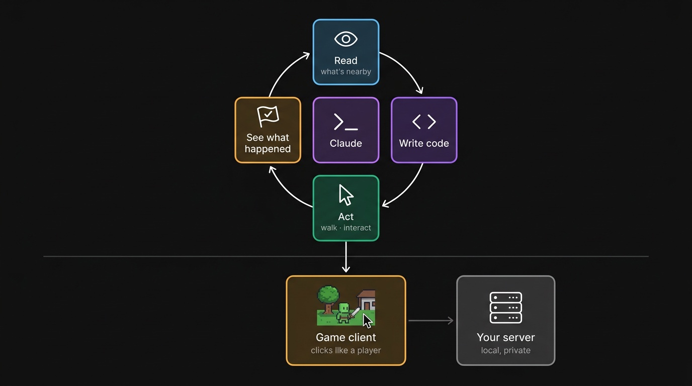
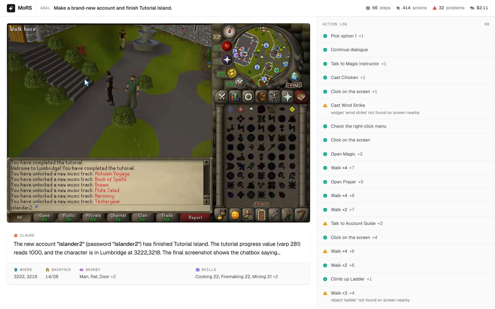

# How MoRS works

Claude gets two APIs, and the actions are deliberately tiny.

| API | What it does |
|---|---|
| `GET /state` | **Read.** Everything a player sees at a glance, as JSON. |
| `POST /act` | **Act.** Basically two moves: **walk** to a tile, or **interact** with something by name and option ("Talk-to Cook", "Chop down Tree", "Open Door"). Keys and typing cover dialogue. |

Everything bigger, like `chop`, `talkTo` or a whole quest, is ordinary code on top of those two. The game decides what happens, just as it would for a player.

How a request travels:

1. **Claude** calls `execute_code` with a bit of TypeScript. The MCP server (`mcp/index.ts`) runs it with `sdk` in scope.
2. **The SDK** (`sdk/`) turns each call into `GET /state` or `POST /act` on the gateway (`gateway/server.ts`, port 8888).
3. **The game client** is RuneLite's injected OSRS client, loaded by a small loader and running headless in Docker. Its `Bridge` reads the game for `/state`. For `/act` it hovers the target and picks the game's own menu option. No hand-made packets, no teleports, and `::` commands are blocked.
4. **Your server** (OpenRune, local) sees a normal player.
5. **You watch live.** The client streams frames to the gateway, and the viewer at http://localhost:8888 shows the game, the state Claude is given, and Claude's thoughts and steps.

When something can't be done, the error says why ("stuck at 3102,3368; a door/gate may be in the way"), and Claude adapts.

## The viewer

- **Header:** the goal you gave Claude, then steps, actions, problems and time (or cost, once the run is done).
- **Game:** the live client. You can click and type into it too.
- **Claude:** its latest thought, and under it one row of the state it reads: where it is, the tutorial step, the backpack, what's nearby, skills. Only what the game screen doesn't already show.
- **Running:** the script Claude is executing right now, as highlighted TypeScript.
- **Action log:** every earlier step, one line each, with an error line only when something failed. Click a step for why Claude did it, what happened, and the code.

It's React with [shadcn/ui](https://ui.shadcn.com) and filled [Phosphor](https://phosphoricons.com) icons, styled after [`DESIGN.md`](../DESIGN.md): light only, ink on white, colour only for status. Bun bundles it on the fly; restart the gateway after editing `web/`, because the bundle is cached.

The same components render the videos: `?video` gives a fixed 1280×720 layout that `tools/video/panel.ts` replays a recorded log into.

## Timing

One game tick is 600ms. The Bridge runs every game read on the client thread (once per frame) and every input on the Swing thread, like real input. SDK helpers poll the state every 200 to 300ms until something changes.

## Where things live

| You want to change… | Look in |
|---|---|
| What Claude can call | `mcp/index.ts` (tools + the API cheat sheet Claude sees) |
| High-level helpers (`walkTo`, `chop`, `talkTo`, …) | `sdk/api.ts` |
| What's in the state, or how an action is performed | `client/src/mors/Bridge.java` |
| The agent cursor and target outline drawn on frames | `client/src/mors/AgentOverlay.java` |
| Frame streaming and remote input | `client/src/mors/GatewayLink.java` |
| The viewer | `web/app.tsx` (layout), `web/timeline.ts` (turns events into steps), `web/components/ui/` (shadcn) |
